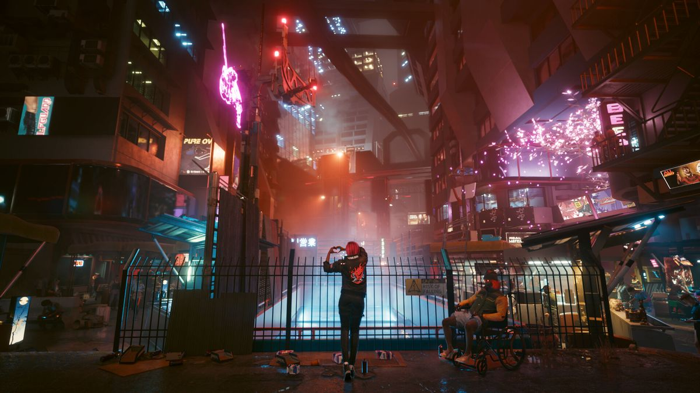

# Pixelizer

This program pixelizes the provided image in squares of given size. It can run in either the single threaded or the multi threaded mode. In the latter, the work will be split among all of the available cores. The program also shows live progress using a GUI window with the image inside it. After the processing is done, the result is saved to `result.jpg`.

## How to Run

To run the code, you should have Rust and Cargo installed on your machine. If you don't, you may consult [the official website](https://rust-lang.org/tools/install/) for the instructions on how to do it. After this, the program can be launched using the following command:

```bash
cargo run -- <filename> <square size> <processing mode>
```

_Note: Cargo may take some time to download and compile all of the dependencies this project relies on during the first launch._

Explanation of the parameters:

- `filename`: The path to the image you want to process.
- `square size`: The length of the side of a square in which the image will be subdivided (in pixels). Must be a positive integer (`>= 1`). If `square size` is larger than one of the image's dimensions, the program will use that dimension's value. Note that the rectangles on the rims of the image may be smaller than expected since the dimensions of the image may not be perfectly divisible by `square size`.
- `processing mode`: Either `S` (single threaded) or `M` (multi threaded).

## External Dependencies

This project relies on several external dependencies:

- [`winit`](https://crates.io/crates/winit): A cross-platform library that enables the program to create GUI windows.
- [`softbuffer`](https://crates.io/crates/softbuffer): Allows the program to render an image inside a `winit` window.
- [`image`](https://crates.io/crates/image): Image processing and codec (not used for pixelization).
- [`rdev`](https://crates.io/crates/rdev): Used only to get the display size in this project.
- [`core_affinity`](https://crates.io/crates/core_affinity): Used to get the cores and pin the workers to specific cores in the multi threaded mode.

## Implementation Details

### Display Image Downsizing

If the input image is too large to fit on the screen, the display image will be downsized for better demonstration while preserving the aspect ratio. This downsizing is only cosmetic - the processing will still be done on the original image. The result in `result.jpg` will have the same dimensions as the original image.

The downsizing is done using nearest-neighbor sampling. It was chosen because it is the cheapest option. As a result, there may be tiny visual bugs in some places in the demonstration, but I believe it is acceptable since the demonstration image does not affect the real result in any way.

### Pixelization

Pixelization is done by computing the averages of each of the color channels in a given square and then constructing the "average" color from these channel averages.

### Concurrency

The program will try to use one thread per each available core on the machine. However, it will use fewer than that if the square size is too large. For instance, if you set the square size to 500 and the image's height is 1000, only two threads will be used.

Internally, all of the pixels are converted to atomic numbers. Since the threads do not have overlapping regions, it would make sense to use regular numbers (as there can be no data races), but Rust's philosophy and compiler do not allow thread-unsafe types to be used in a concurrent environment under any circumstances.

Since Rust is blazingly fast, each thread will sleep for some time after processing each square. Currently, it will sleep for 100 microseconds for each pixel in the square size. However, this may still lead to pretty slow or extremely fast execution times in some circumstances. You may want to increase the `SLEEP_DURATION_FACTOR` in `src/averaging.rs` in such cases.

## Examples

Example image (taken from [here](https://www.imdb.com/news/ni66076801)):



After running `cargo run -- images/example.jpg 10 M`:


After running `cargo run -- images/example.jpg 20 S`:


After running `cargo run -- images/example.jpg 50 S`:


